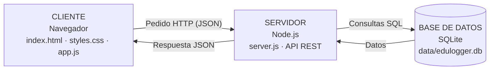

# EDULOGGER

Asistente docente para gestionar **lista de alumnos, asistencia y calificaciones** de uno o varios cursos, usando JavaScript sin frameworks, un servidor **Node.js** propio y una base de datos **SQLite**.

> ⚠️ Es un proyecto académico: usá únicamente **datos ficticios** para las pruebas. Los datos reales de alumnos no deben subirse a este repositorio público (ver [Seguridad y datos](#seguridad-y-datos)).

## Objetivo

**EDULOGGER** es una planilla digital pensada para docentes que necesitan llevar el registro de sus cursos de forma simple y ordenada. Permite administrar la lista de alumnos, registrar la asistencia y cargar las calificaciones en un solo lugar, sin depender de planillas en papel ni de hojas de cálculo sueltas.

El proyecto busca:

- Reducir el tiempo que el docente dedica al registro administrativo diario.
- Evitar la pérdida o el desorden de la información de cada curso.
- Mantener los datos guardados de forma local, sin necesidad de servicios externos ni conexión a internet.
- Aplicar en un caso real los conceptos de arquitectura cliente-servidor: una interfaz web, un servidor Node.js con API REST y una base de datos SQLite.

Es un trabajo académico desarrollado por Lorena Arroyo y Daiana Ortega.

## Diagrama del proyecto



El proyecto sigue el modelo **cliente-servidor**:

- **Cliente:** el navegador, que ejecuta `index.html`, `styles.css` y `app.js`. Muestra la interfaz y envía pedidos al servidor, pero no guarda datos por sí mismo.
- **Servidor:** una aplicación Node.js (`server.js`) que entrega los archivos de la carpeta `public/` y expone una **API REST** (`/api/...`) que recibe los pedidos del navegador.
- **Base de datos:** un archivo **SQLite** (`data/edulogger.db`) que guarda cursos, alumnos, notas, asistencia y ajustes. Se crea sola al iniciar el servidor a partir de `schema.sql`.

**Recorrido de un pedido:**

1. La persona usa la interfaz de `index.html` (por ejemplo, marca la asistencia o carga una nota).
2. `app.js` toma los datos y envía el pedido HTTP a la API del servidor.
3. `server.js` recibe el pedido, lo valida y ejecuta la consulta SQL sobre la base de datos.
4. SQLite guarda o devuelve los datos y el servidor responde en formato JSON.
5. `app.js` recibe la respuesta y actualiza la pantalla.

## Funcionalidades

- **Crear un curso desde una foto:** se saca una foto a la lista impresa (o se pega una captura o una lista) y EDULOGGER lee los nombres y arma el curso.
- **Gestión de alumnos:** lista editable de cada curso, con encabezado personalizable (curso, turno, año, profesor, preceptor y asignatura).
- **Asistencia:** registro por fecha con estados Presente, Ausente y Justificado, resumen del día, y opciones "Todos presentes" y "Todos ausentes". También permite tomar asistencia desde una foto y compartirla.
- **Calificaciones:** planilla con notas de 1 a 10 por trimestre, "A" para ausente, cálculo automático de la calificación final y columnas para instancias de diciembre y febrero/marzo. Las notas se colorean según el resultado (aprobado, desaprobado, aplazado).
- **Avisos:** pendientes de cada curso (por ejemplo, notas sin cargar o asistencia sin tomar) y un recordatorio diario configurable de lunes a viernes.
- **Varios cursos:** se puede trabajar con más de un curso a la vez.
- Datos guardados en una base de datos local (SQLite).

## Tecnologías

| Herramienta | Uso |
|-------------|-----|
| HTML + CSS | Interfaz de usuario (`index.html`, `styles.css`) |
| JavaScript | Lógica de la página y comunicación con la API (`app.js`) |
| Node.js 22.13 o superior | Servidor y API REST (`server.js`) |
| SQLite | Base de datos local (`edulogger.db`) |

## Estructura

```
eduloggerDL/
├── LICENSE
├── README.md
└── edulogger/
    ├── server.js          # Servidor: API REST + archivos estáticos
    ├── schema.sql         # Tablas: courses, students, grades, attendance, settings
    ├── package.json
    ├── .gitignore         # Excluye node_modules y la base de datos
    ├── data/
    │   ├── .gitkeep
    │   └── edulogger.db   # Base de datos (se crea sola al iniciar)
    └── public/
        ├── index.html     # Interfaz
        ├── css/
        │   └── styles.css # Estilos
        └── js/
            └── app.js     # Lógica del cliente
```

## Puesta en marcha

### 1. Instalar Node.js

Descargá **Node.js 22.13 o superior** desde https://nodejs.org y verificá la versión:

```bash
node -v
```

### 2. Clonar y abrir el proyecto

```bash
git clone https://github.com/ortegadn24/eduloggerDL.git
```

En Visual Studio Code: *Archivo → Abrir carpeta…* y elegí la carpeta `edulogger` (dentro de `eduloggerDL`).

### 3. Ejecutar

Abrí la terminal (`Ctrl + ñ`) y ejecutá:

```bash
npm start
```

No necesita `npm install` ni configurar variables de entorno: la base de datos se crea sola al iniciar.

Abrí http://localhost:3000 en el navegador.

Para que el servidor se reinicie automáticamente al editar archivos:

```bash
npm run dev
```

> **Windows / PowerShell:** si aparece el error de "ejecución de scripts deshabilitada", ejecutá una vez
> `Set-ExecutionPolicy -Scope CurrentUser -ExecutionPolicy RemoteSigned`
> o usá la terminal CMD.

> No abras `index.html` con doble clic ni con Live Server: la aplicación necesita el servidor Node.js para guardar los datos.

## API

El cliente se comunica con el servidor a través de estas rutas:

| Método | Ruta | Qué hace |
|--------|------|----------|
| GET | `/api/state` | Devuelve cursos, alumnos, notas, asistencia y ajustes |
| PUT | `/api/courses/:id` | Crea o actualiza un curso completo |
| DELETE | `/api/courses/:id` | Elimina un curso |
| PUT | `/api/settings` | Guarda el recordatorio y el curso actual |

## Seguridad y datos

- **La base de datos no se sube a GitHub:** `data/*.db*` está en `.gitignore`, y `node_modules` también. Cada instalación arranca con una base nueva y vacía.
- **Los datos quedan solo en la computadora donde se ejecuta el servidor.** Para conservarlos, copiá de vez en cuando el archivo `data/edulogger.db`.
- **Sin inicio de sesión:** cualquier persona que acceda a `localhost:3000` en esa computadora puede ver y modificar los datos. Es un proyecto de uso local, no está preparado para publicarse en internet.
- **Usá solo datos ficticios** al hacer pruebas.

## Notas

- Si había cursos guardados en el navegador (versión anterior), se migran solos la primera vez.

## Mejoras futuras

- Exportar listas, asistencia y notas a Excel o PDF
- Estadísticas y promedios por curso y por alumno
- Inicio de sesión para distintos docentes
- Copias de seguridad automáticas de la base de datos
- Versión adaptada a celulares

## Autoras

- **Arroyo, Lorena**
- **Ortega, Daiana** - GitHub: [@ortegadn24](https://github.com/ortegadn24)

## Licencia

Distribuido bajo licencia MIT. Ver el archivo `LICENSE`.